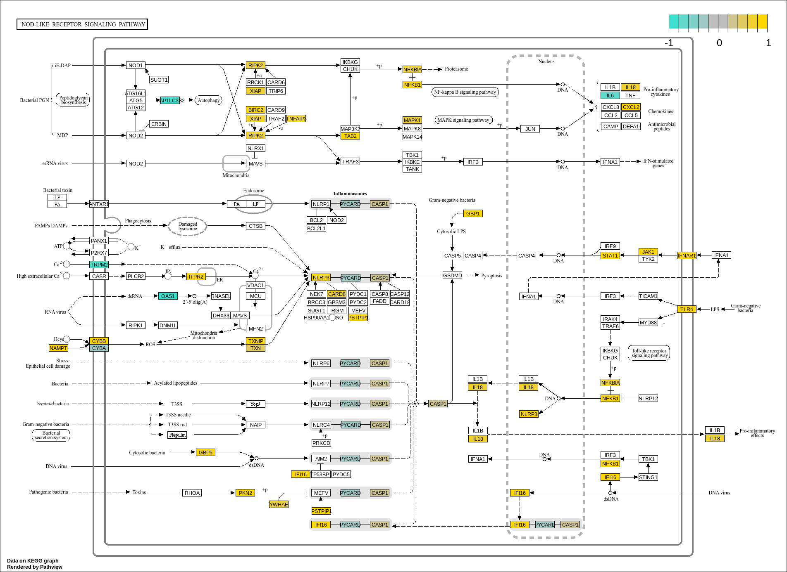

# KEGGPathviewGen4SCODA

An R package for generating KEGG pathway images from [SCODA](https://mlbi-lab.net) single-cell RNA-seq analysis results. It connects SCODA gene set analysis (GSA) results to KEGG pathways and uses gene-level log2 fold changes to color pathway diagrams for a selected cell type and comparison.

The package visualizes **existing SCODA results**; it does not perform differential expression or enrichment analysis from a raw expression matrix.

## Example output



The gene color scale runs from **turquoise** (negative log2 fold change), through **gray** (zero), to **gold** (positive log2 fold change). Interpret the direction relative to the comparison and reference used in the SCODA analysis. Unmapped or filtered genes should not be interpreted as evidence of unchanged expression.

## Requirements and installation

Use an R session, RStudio, or a Jupyter notebook with an R kernel. Python is also required for AnnData access through `reticulate`. Internet access is needed for package installation and retrieval of KEGG resources. The current gene annotation workflow is designed for **human and mouse** data.

Run the following in R:

```r
install.packages(c(
  "BiocManager", "remotes", "dplyr", "stringr",
  "filesstrings", "reticulate", "anndata"
))

BiocManager::install(c(
  "biomaRt", "pathview", "gage", "gageData",
  "org.Hs.eg.db", "org.Mm.eg.db"
), update = FALSE, ask = FALSE)

remotes::install_github("combio-dku/KEGGPathviewGen4SCODA", upgrade = "never")
```

`biomaRt` is used by the implementation and is installed explicitly above, although it is not currently listed in `DESCRIPTION`. Use a Bioconductor release compatible with your R version; see the [Bioconductor installation guide](https://bioconductor.org/install/). GitHub installation uses [`remotes::install_github()`](https://remotes.r-lib.org/reference/install_github.html).

## Input data

Provide a **SCODA-processed AnnData object**, typically loaded from a `.h5ad` file. A generic AnnData file containing only expression values is insufficient. The workflow reads these entries from `adata$uns`:

| Entry | Expected contents |
| --- | --- |
| `usr_param` → `species` | Human (`human`, `hs`, `hsa`) or mouse (`mouse`, `mm`, `mmu`). Use lowercase KEGG codes. |
| `Pathways_DB` | Named pathway gene sets used by SCODA, with gene symbols that can be mapped to Entrez IDs. |
| `DEG_vs_ref` (default `deg.key`) or `DEG` | Nested results indexed by cell type and comparison; each DEG table contains `pval` and `log2_FC`, with gene symbols as row names or an `ENTREZID` column. |
| `GSA_vs_ref_up` (default `gsa.key`) or `GSA_up` | Nested results indexed by cell type and comparison; each GSA table contains `pval`, with pathway names as row names matching `Pathways_DB`. |

DEG and GSA results must contain the selected cell type and matching comparison names. Other result keys can be supplied through `deg.key` and `gsa.key` when present in your file.

## Quick start

### 1. Prepare the R session

Load the libraries explicitly, as in the example notebook: the current package uses several dependency functions without namespace qualification.

```r
library(dplyr)
library(stringr)
library(filesstrings)
library(pathview)
library(gage)
library(gageData)
library(org.Hs.eg.db)
library(org.Mm.eg.db)
library(reticulate)

# Declare Python requirements before loading data or initializing Python.
reticulate::py_require("anndata")
library(anndata)
library(KEGGPathviewGen4SCODA)
```

This uses a version of `reticulate` that provides `py_require()`. If you already select a Python environment explicitly, install Python `anndata` in that environment. `py_require()` uses a managed environment only when another Python installation has not taken precedence. See the [reticulate documentation](https://rstudio.github.io/reticulate/reference/py_require.html).

### 2. Load your SCODA result

Extract your SCODA result archive if necessary, then replace the example path with the actual `.h5ad` file:

```r
adata_t <- anndata::read_h5ad("path/to/your_scoda_result.h5ad")

deg_key <- "DEG_vs_ref"
gsa_key <- "GSA_vs_ref_up"

names(adata_t$uns)
adata_t$uns[["usr_param"]][["species"]]

target_list <- intersect(
  names(adata_t$uns[[deg_key]]),
  names(adata_t$uns[[gsa_key]])
)
print(target_list)
```

**Current implementation note:** keep the object named `adata_t` in the global R session. An internal helper currently reads DEG results from that name instead of its `adata` argument. When switching datasets, update `adata_t` as well.

For a downloadable colitis example and an interactive walkthrough, see [the example notebook](example_kegg_pathview_gen_for_scoda.ipynb). Its sample-data route additionally uses the Python packages `mlbi-datasets` and `gdown`.

### 3. Map SCODA pathways to KEGG

```r
df_pathways_map <- get_pathways_map(adata_t, min_overlap = 0.85)
head(df_pathways_map)
```

For each SCODA gene set, the function selects the KEGG gene set with the **largest number of shared Entrez IDs**, then retains it if:

```text
number of shared genes / min(SCODA gene set size, KEGG gene set size) >= min_overlap
```

This is an overlap-based correspondence, not an exact name match or an enrichment test. The returned data frame contains `pw_id`, `pw_name`, `pw_id_name`, and `pw_name_used`. Inspect the mapping before interpreting the images.

### 4. Generate images for a cell type

Choose a cell type from `target_list`. The example below uses `Macrophage`; replace it if your data uses another label.

**Output behavior:** results are written under the current working directory. If `KEGG_pathview_<cell type>` already exists, the function attempts to delete its existing files before generating new images. Use a separate working directory for a new run if you need to preserve earlier results.

```r
target_cell <- "Macrophage"
stopifnot(target_cell %in% target_list)

dir_saved <- save_kegg_pathviews(
  adata = adata_t,
  target_cell = target_cell,
  df_pathways_map = df_pathways_map,
  pathways = NULL,
  deg.p.val.cutoff = 0.01,
  gsa.p.val.cutoff = 0.01,
  deg.key = deg_key,
  gsa.key = gsa_key,
  deg_fc_limit = 4
)

print(dir_saved)
list.files(dir_saved, pattern = "\\.png$", full.names = TRUE)
```

The function returns the output folder name, such as `KEGG_pathview_Macrophage`. Generated PNG filenames follow `<KEGG pathway name>_<comparison>.png`.

To restrict a run to selected pathways, replace `pathways = NULL` with a character vector of **exact KEGG pathway names** from `df_pathways_map$pw_name`, for example:

```r
pathways = c("TNF signaling pathway", "IL-17 signaling pathway")
```

This is an argument replacement in the call above. Selected pathways must still pass the GSA filter and have a retained KEGG mapping; listing a pathway does not force it to be rendered.

## Main parameters

| Function / parameter | Default | Meaning |
| --- | --- | --- |
| `get_pathways_map()` → `min_overlap` | `0.85` | Minimum overlap ratio for the selected KEGG match. |
| `save_kegg_pathviews()` → `target_cell` | Required | Cell-type label present in both selected DEG and GSA results. |
| `df_pathways_map` | Required | Output of `get_pathways_map()`. |
| `pathways` | `NULL` | All eligible pathways, or a vector of exact KEGG pathway names. |
| `deg.p.val.cutoff` | `0.01` | Retain genes whose DEG `pval` is at or below this value. |
| `gsa.p.val.cutoff` | `0.01` | Retain pathways whose GSA `pval` is at or below this value. |
| `deg.key` | `"DEG_vs_ref"` | Key containing differential expression results. |
| `gsa.key` | `"GSA_vs_ref_up"` | Key containing gene set analysis results. |
| `deg_fc_limit` | `4` | Log2 fold-change color scale limit; this clips the display scale, not the input DEG table. |

The filters read the column named **`pval`** directly. They do not select an adjusted-p-value column or calculate a multiple-testing correction. The default GSA key selects the stored upregulated-gene enrichment results; gene colors still use the signed fold changes in the selected DEG results.

## Troubleshooting and current limitations

- **Missing `adata_t`:** use the object name shown above, even when passing it through the `adata` argument.
- **Missing R function or annotation object:** run the library-loading block. If `biomaRt` is missing, install it with `BiocManager`.
- **Python module not found:** check `reticulate::py_config()` and install dependencies in the Python environment actually used by R. Restart R before changing Python environments.
- **No images or an error with empty results:** inspect the selected keys, cell type, comparison names, DEG/GSA tables, and retained mappings. The current implementation does not consistently handle empty result sets and may error instead of returning an empty folder.
- **Unexpectedly few mapped pathways:** inspect gene identifiers and the mapping output. The current conversion code also has an empty-index edge case when no missing Entrez IDs are found; lowering `min_overlap` alone may not resolve this.
- **KEGG retrieval fails:** check connectivity and retry later. Pathway resources and gene annotations can change, so record package versions and retain input data and mapping tables for reproducibility.

## Related materials

- [Example R notebook](example_kegg_pathview_gen_for_scoda.ipynb)
- [SCODA workshop materials](https://github.com/combio-dku/mlbi-workshop)
- [R implementation](R/kegg_pathview_gen.R)

## License

Distributed under the [MIT License](LICENSE).
